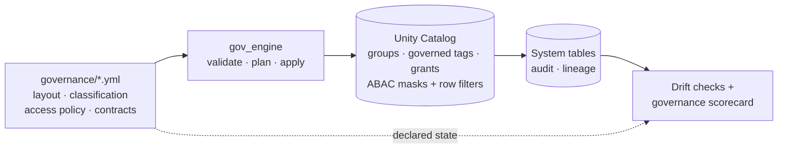

# Lakehouse Governance as Code

[](https://github.com/felipecastro-data/lakehouse-governance-as-code/actions/workflows/ci.yml)


**Unity Catalog governance on Databricks Free Edition, declared in Git, applied by an engine, checked for drift, and measured.**

Every group, governed tag, grant and ABAC policy in this lakehouse comes from four YAML files.
A small Python engine validates them, renders idempotent Unity Catalog SQL, and applies it through a
Databricks Asset Bundle job deployed by a service principal. Change who can see personal data with a
one-line pull request.



## What this demonstrates

| Area | How |
|---|---|
| **Data architecture** | Catalog per environment, `<domain>_<layer>` schemas, clear ownership split between bundle and engine ([ADRs](docs/adr)) |
| **Access control** | Group-only grants, least privilege, no human writes in prod, break-glass group, service-principal deploys ([access matrix](docs/generated/access-matrix-prod.md)) |
| **Classification** | 4 levels and PII types as **governed tags**; Databricks auto-classification tags as a safety net |
| **Data protection** | **Native ABAC**: one catalog policy per PII type, row filter policy backed by a mapping table, pseudonymization |
| **Data contracts** | [ODCS v3](https://bitol-io.github.io/open-data-contract-standard/) contract per governed table |
| **Verification** | Spec validation in CI, drift detection, PII propagation check via column lineage *(Phase 3)* |
| **Observability** | Audit + lineage views and a governance scorecard *(Phase 4)* |
| **Platform engineering** | Databricks Asset Bundles, GitHub Actions, unit + consistency tests |

## How a policy becomes enforcement

A contract marks a column as PII:

```yaml
# governance/contracts/customer.customers.yml
- name: email
  logicalType: string
  customProperties:
    - property: piiType
      value: email
```

`classification.yml` says `email` is **confidential**, masked with `partial_email`, and only
`pii_readers` may unmask confidential data. The engine tags the column, and one catalog-wide ABAC
policy does the rest, for this table and every future one:

```sql
ALTER TABLE gov_prod.customer_silver.customers ALTER COLUMN `email`
  SET TAGS ('classification' = 'confidential', 'pii_type' = 'email');

CREATE OR REPLACE POLICY mask_email ON CATALOG gov_prod
COLUMN MASK gov_prod.governance.mask_email
TO `account users` EXCEPT `gov-pii-readers`, `gov-pii-restricted-readers`
FOR TABLES
MATCH COLUMNS has_tag_value('pii_type', 'email') OR has_tag('class.email_address') AS col
ON COLUMN col;
```

An analyst sees `j***@example.com`; a member of `gov-pii-readers` sees the real address. A column
that Databricks auto-classifies as `class.email_address` is masked too, even without a contract.
Full rendered plan: [docs/generated/plan-prod.sql](docs/generated/plan-prod.sql).

## Repository layout

```
governance/            the policy — single source of truth
  layout.yml           environments, domains, layers
  classification.yml   levels, mask strategies, PII types
  access_policy.yml    principals, grants, row filters
  contracts/           ODCS data contracts per table
src/gov_engine/        validate · render · apply · groups + governed tags sync · (drift, lineage)
src/jobs/              Databricks job entrypoints
resources/             bundle resources: schemas, jobs
databricks.yml         bundle targets (dev, prod)
docs/                  plan, architecture, ADRs, RACI, production deltas
tests/                 spec, render, apply and bundle-consistency tests
```

## Quickstart

```bash
make setup                 # .venv + dev dependencies
make test                  # unit + consistency tests
make validate              # validate governance/*.yml
make plan ENV=prod         # preview the SQL
make matrix ENV=prod       # access matrix as Markdown
```

Deploy to Databricks Free Edition (findings from the [Day-0 spike](docs/spike-checklist.md)):

```bash
databricks auth login --host https://<your-workspace>.cloud.databricks.com
make apply ENV=dev         # create catalog (SQL) + bundle deploy (schemas, job) + governance_apply
```

The apply job creates missing account groups and governed tags, then runs the SQL plan. In CI the
same commands run as the `gov-deployer` service principal ([ADR-0006](docs/adr/0006-deploy-service-principal.md)).

## Status

| Phase | Scope | Status |
|---|---|---|
| 0 | Free Edition capability spike | ✅ |
| 1a | Scaffold: spec, engine, bundle, CI, docs; redesign on native ABAC | ✅ |
| 1b | Deploy as `gov-deployer`, sync groups + governed tags, apply grants and policies | ⏳ |
| 2 | Synthetic data, bronze → silver → gold | ⏳ |
| 3 | Policies live on data, drift detection, PII propagation | ⏳ |
| 4 | Audit + lineage views, scorecard dashboard | ⏳ |
| 5 | Right-to-erasure, scripted demo | ⏳ |

Full plan: [docs/PLAN.md](docs/PLAN.md).

## Free Edition trade-offs

Built on a single serverless workspace, so environments are catalogs and some enterprise controls
are out of reach. Each trade-off is documented with its enterprise equivalent in
[docs/production-deltas.md](docs/production-deltas.md).

## License

MIT
