<div align="center">

# 🛡️ Lakehouse Governance as Code

**A governed Databricks lakehouse where every access rule, classification, mask, row filter and
erasure request is declared in Git, applied by an engine, checked for drift, and measured on a scorecard.**

[](https://github.com/felipecastro-data/lakehouse-governance-as-code/actions/workflows/ci.yml)
[](https://github.com/felipecastro-data/lakehouse-governance-as-code/actions/workflows/deploy.yml)


[Why](#-why-this-project) · [Architecture](#-architecture) · [Features](#-features) · [Demo](#-see-it-run) ·
[Right to erasure](#-right-to-erasure-in-one-command) · [Results](#-results) · [Decisions](#-architecture-decisions) · [Quickstart](#-quickstart)

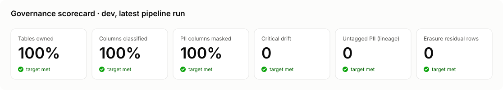

</div>

---

## 💡 Why this project

Most Unity Catalog demos show **features**: here is a mask, here is a grant. Real data teams struggle with
something else: keeping hundreds of grants, tags and policies **correct over time**, proving it to an
auditor, and honouring a customer's request to be forgotten across every copy of their data.

This repository treats governance as a **program**, not a configuration:

| | Step | What happens |
|---|---|---|
| 📝 | **Declare** | Policy lives in five YAML files: layout, classification, access policy, privacy, and one ODCS data contract per table |
| ⚙️ | **Apply** | A small Python engine validates the spec and renders idempotent Unity Catalog SQL, run by a service principal from CI |
| 🔒 | **Enforce** | Catalog-wide **native ABAC policies** mask PII and filter rows by matching governed tags, for every current and future table |
| 🔍 | **Verify** | Drift detection, a column-lineage PII propagation check and an erasure check run in every pipeline and fail it on violations |
| 📊 | **Measure** | A scorecard and an AI/BI dashboard for auditors, built on curated views over system tables |

> **Change who can see personal data with a one-line pull request.** CI validates it, renders the SQL
> diff and access matrix for review, and the deploy workflow applies it.

---

## 🏗️ Architecture

```mermaid
flowchart LR
    subgraph GIT["📁 Git: single source of truth"]
        direction TB
        Y1[layout.yml]
        Y2[classification.yml]
        Y3[access_policy.yml]
        Y4[privacy.yml]
        Y5[contracts/*.yml<br/>ODCS v3]
    end

    subgraph CI["🚦 GitHub Actions"]
        direction TB
        V[validate · test · lint]
        P[render SQL plan +<br/>access matrix for review]
        D[bundle deploy<br/>as gov-deployer SP]
    end

    subgraph DBX["🧱 Databricks · Unity Catalog"]
        direction TB
        E[gov_engine apply<br/>groups · governed tags · grants · ABAC]
        L[(bronze → silver → gold<br/>customer · sales)]
        CHK[drift · PII lineage · erasure<br/>checks]
        SC[(audit schema<br/>views · scorecard)]
        DB[📊 AI/BI dashboard<br/>for auditors]
    end

    GIT --> V --> P --> D --> E --> L --> CHK --> SC --> DB
    GIT -. declared state .-> CHK
```

**One catalog per environment** (`gov_dev`, `gov_prod`), schemas named `<domain>_<layer>` so a single
selector like `layers: [gold]` grants "all data products":

```
gov_prod
├── customer_bronze · customer_silver · customer_gold
├── sales_bronze    · sales_silver    · sales_gold
├── governance      mask + filter functions, region mapping, erasure register
└── audit           admin-owned views over system tables, scorecard history, erasure log
```

**Clear ownership** (no two tools manage the same object):

| Concern | Owner |
|---|---|
| Catalog | `gov_engine ensure-catalog` (SQL, before deploy) |
| Schemas, jobs, dashboard | Databricks Asset Bundle |
| Account groups, governed tags | `gov_engine` (REST API) |
| Grants, tags, ABAC policies, functions | `gov_engine` (SQL rendered from YAML) |
| Group membership | People, through access requests |

More: [architecture.md](docs/architecture.md) · [RACI](docs/raci.md) · [project plan](docs/PLAN.md)

---

## ✨ Features

### 🔒 Classification-driven masking with native ABAC

A contract marks a column as PII. That is the **only** thing a data producer writes:

```yaml
# governance/contracts/customer.customers.yml
- name: email
  logicalType: string
  customProperties:
    - property: piiType
      value: email
```

`classification.yml` says `email` is **confidential**, masked with `partial_email`, and only
`pii_readers` may see it in clear. The engine tags the column, and **one catalog-wide policy** protects it
in this table and every future one:

```sql
ALTER TABLE gov_prod.customer_silver.customers ALTER COLUMN `email`
  SET TAGS ('classification' = 'confidential', 'pii_type' = 'email');

CREATE OR REPLACE POLICY mask_email ON CATALOG gov_prod
COLUMN MASK gov_prod.governance.mask_email
TO `account users` EXCEPT `gov-pii-readers`, `gov-pii-restricted-readers`, `gov-pipeline-runners`
FOR TABLES
MATCH COLUMNS has_tag_value('pii_type', 'email') OR has_tag('class.email_address') AS col
ON COLUMN col;
```

A column that Databricks **auto-classifies** as `class.email_address` is masked too, even before anyone
writes a contract for it.

| PII type | Level | Mask | Analyst sees |
|---|---|---|---|
| `person_name` | confidential | initial only | `U.` |
| `email` | confidential | partial | `u***@example.com` |
| `phone` | confidential | last 4 | `********1679` |
| `date_of_birth` | confidential | year only | `1948-01-01` |
| `street_address` | confidential | redact | `***REDACTED***` |
| `national_id` | **restricted** | SHA-256 (joinable, not reversible) | `94c27a45a3a8…` |
| `card_number` | **restricted** | last 4 | `************6688` |

### 🌍 Row-level security from a mapping table

A row filter policy matches the governed `filter_key` tag and checks a group → region mapping table that
the engine overwrites from `access_policy.yml`. Giving EMEA analysts APAC access is a one-line PR, no SQL.

### 👥 Least privilege, group-only access

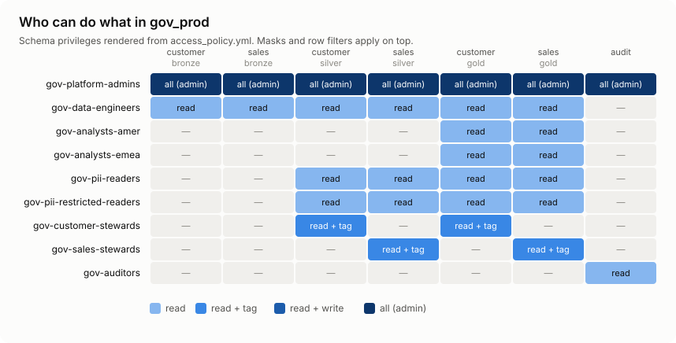

- **No individual grants**: drift detection flags any grant to a user as critical.
- **No human writes in prod**: only the `gov-deployer` service principal (OAuth M2M) deploys and writes.
- **Analysts never see bronze**; **auditors never touch `system.*`**, only curated views.
- Full generated matrix, reviewed on every PR: [access-matrix-prod.md](docs/generated/access-matrix-prod.md).

### 📜 Data contracts that create the tables

Every governed table has an [ODCS v3](https://bitol-io.github.io/open-data-contract-standard/) contract
with an owner, classification per column and quality rules. The engine **creates and tags the table
from the contract before any data lands**, so there is never a moment when PII sits unprotected. The
contracts' quality rules (uniqueness, not null, referential integrity) gate the pipeline.

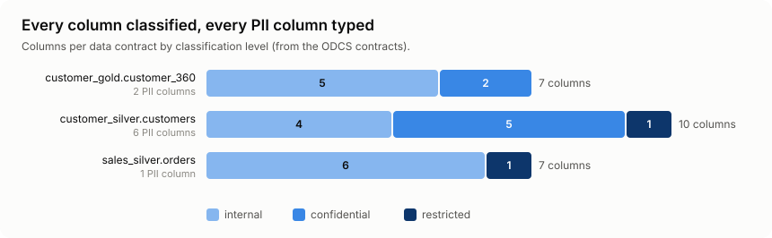

### 🔍 Continuous verification

| Check | Catches | Severity |
|---|---|---|
| **Drift** | A `GRANT` run by hand, a removed PII tag, an altered ABAC policy, a per-column mask outside ABAC, a contract column whose type changed | critical fails the pipeline |
| **PII propagation** | A silver/gold column **fed by PII through column lineage** that has no `pii_type` tag, so no mask applies | critical |
| **Erasure** | Rows of an erased customer still present anywhere, or a table fed by customer data that has no subject key | critical |
| **Quality** | Contract rules: uniqueness, not null, referential integrity | fails the pipeline |

Drift is **reported, never auto-revoked**: a person decides whether the spec or the workspace is wrong.

### 📊 Audit views and a governance scorecard

An account admin owns curated views over `system.access.*` in the `audit` schema, so auditors answer
*"who changed access?"* and *"who read restricted data?"* without system-table access:

| View | Answers |
|---|---|
| `grant_changes` | Every GRANT/REVOKE, with `by_engine` separating the engine from people |
| `policy_changes` | ABAC policy create/update/delete and their exemption lists |
| `table_access` | Reads and writes per principal and table |
| `access_denied` | Requests Unity Catalog refused |
| `column_lineage` | Column lineage, used by the PII propagation and erasure checks |

The pipeline's `scorecard` task records coverage and findings on every run; the AI/BI dashboard reads them
with the **viewer's** credentials (no embedded credentials).

---

## 🎬 See it run

`make demo ENV=dev` walks through the whole program against the live workspace (read-only). Real output:

```text
==============================================================================
 1. DECLARE - policy lives in governance/*.yml
==============================================================================
  2 environments, 2 domains, 8 schemas per catalog
  3 data contracts, 24 columns, 9 PII columns
  4 classification levels, 7 PII types, 10 groups, 9 grant rules

==============================================================================
 2. APPLY - the engine renders idempotent Unity Catalog SQL for gov_dev
==============================================================================
  reference_data    3 statements
  functions         8 statements
  grants           32 statements
  tables            3 statements
  tags             27 statements
  policies          8 statements

==============================================================================
 3. ENFORCE - what you see right now
==============================================================================
  customer_id  full_name  email             phone         date_of_birth  national_id
  -----------  ---------  ----------------  ------------  -------------  ----------------------------
  C000001      U.         u***@example.com  ********1679  1948-01-01     94c27a45a3a81599b9756d72...
  C000002      H.         h***@example.com  ********6873  1988-01-01     e7fe17a6e616b01104c27331...
  C000003      F.         f***@example.com  ********6224  2000-01-01     801867d8ddb81f694b16c6cb...

==============================================================================
 4. VERIFY - drift, PII propagation and erasure, as the pipeline measured them
==============================================================================
  pipeline run 1001129845081114 at 2026-10-30T15:29:22Z
  drift:           0 critical, 0 warning
  pii propagation: 0 untagged PII columns
  erasure:         1 requests, 0 residual rows or gaps

==============================================================================
 5. MEASURE - governance scorecard
==============================================================================
  pct_owned             100 (3/3)    silver/gold tables with an owner tag naming a declared group
  pct_classified        100 (24/24)  silver/gold columns with a classification tag
  pct_pii_masked        100 (9/9)    silver/gold PII columns covered by a live mask policy
  restricted_tables       4          domain tables classified restricted (bronze from lineage)
  drift_critical          0          critical drift findings (fail the drift task)
  untagged_pii            0          silver/gold columns fed by PII without a pii_type tag
  erasure_requests        1          right-to-erasure requests in the register
  erasure_residual        0          rows of erased subjects still present, plus tables erasure can't reach
```

### The pipeline

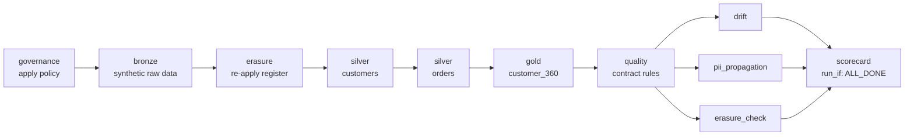

Governance is applied **before** data lands, and the scorecard runs even when a check fails, so a bad run
is on the record too.

### Screenshots

**Governance scorecard dashboard** (AI/BI, for auditors). Every coverage metric sits at 100 and every
finding count at 0 on every run, so the trend lines are flat: that is the goal.

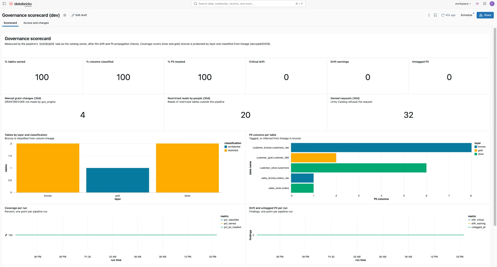

**Access and changes**: who changed grants and who read restricted data, from curated views over
`system.access`. The 4 manual grants listed are the one-time audit-view setup by an admin, flagged because
they did not come from the engine. Email addresses are blurred.

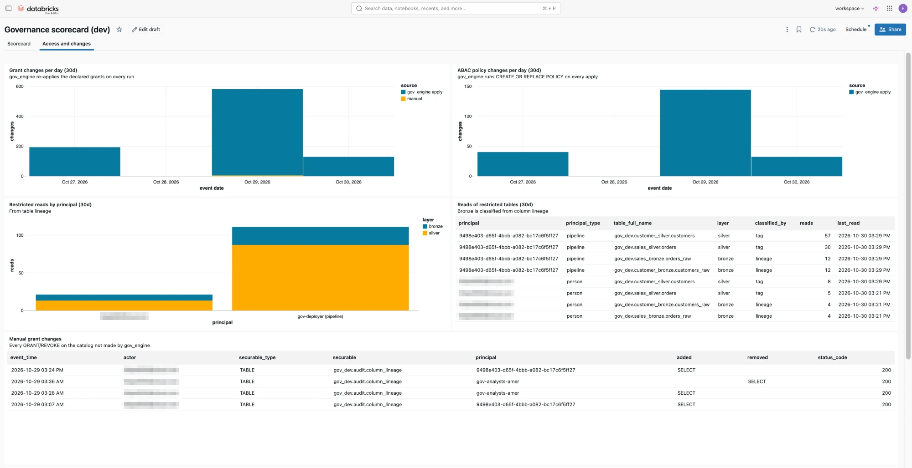

**Denied requests and table inventory**: a test auditor without grants is refused by Unity Catalog (403),
and every domain table carries an owner, a classification and its data contract.

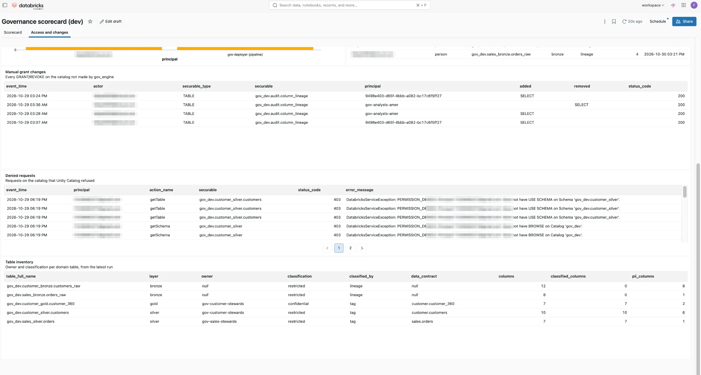

| Pipeline run in Databricks Jobs | PII masked, even for the workspace admin |
|---|---|
| 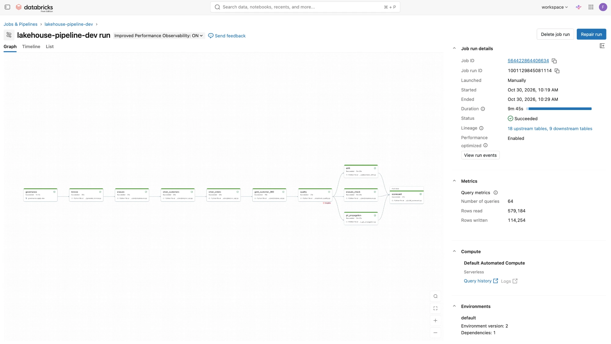 | 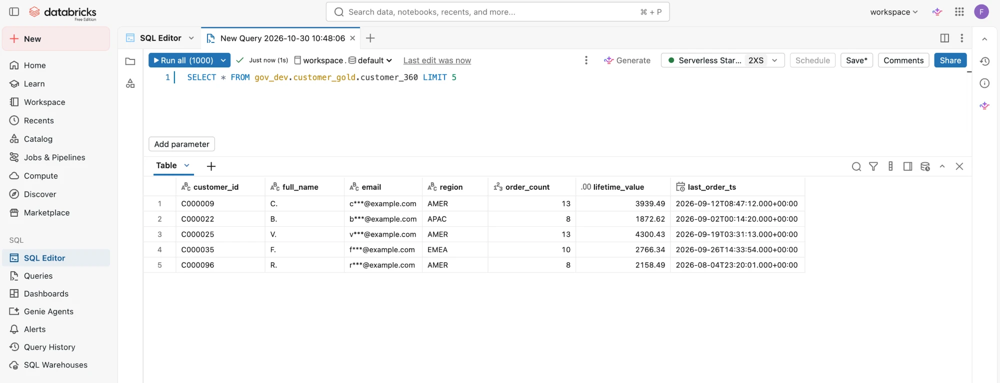 |

---

## 🧹 Right to erasure in one command

GDPR Art. 17 asks you to delete a person from **every copy** of their data and prove it. Here it is one
command, run by an engineer for a request their domain steward approved:

```bash
make erase ENV=dev REQUEST=DSR-0001 SUBJECT=C000042
```

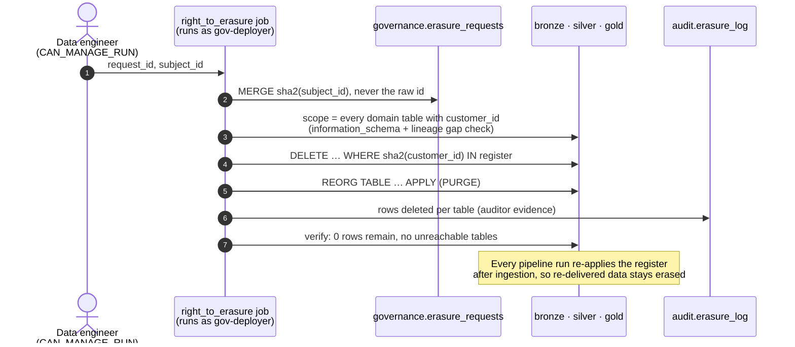

Result in `gov_dev` for customer `C000042` (from `audit.erasure_log`):

| Table | Layer | Rows erased by `DSR-0001` | Re-delivered by the next ingestion, removed before silver |
|---|---|---:|---:|
| `customer_gold.customer_360` | gold | 1 | – |
| `customer_silver.customers` | silver | 1 | – |
| `sales_silver.orders` | silver | 14 | – |
| `customer_bronze.customers_raw` | bronze | 1 | 1 |
| `sales_bronze.orders_raw` | bronze | 14 | 14 |
| **Total** | | **31** | **15** |

`verify`: `1 requests, 5 tables in scope, 0 residual rows, 0 gaps`. The register stores only
`8bace91dd866f585…` (the SHA-256), never `C000042`.

**Design points** ([ADR-0010](docs/adr/0010-right-to-erasure.md)):

- **Scope is discovered, not hard-coded**: any table with `customer_id` is in scope; CI rejects a contract with PII but no subject key.
- **Lineage closes the gap**: a table fed by customer data *without* the key fails the check, because erasure couldn't reach it.
- **The register holds hashes only**: the list of people who asked to be forgotten is not itself a list of people.
- **Separation of duties**: engineers can start the job, but only the deployer identity can delete.
- **Honest about Delta**: rows stay in time travel until VACUUM (7-day retention); that is documented, not hidden.

---

## 📈 Results

Measured in `gov_dev` by the pipeline's scorecard task:

| Metric | Value |
|---|---|
| Synthetic customers / orders ingested (bronze) | 5,169 / 50,260 |
| After cleaning (silver): duplicates, unknown countries, test and orphan orders removed | 4,984 / 48,857 |
| Silver/gold tables with an owner | **100%** (3/3) |
| Silver/gold columns classified | **100%** (24/24) |
| PII columns covered by a live mask policy | **100%** (9/9) |
| ABAC policies (7 masks + 1 row filter) protecting every table | **8**, catalog-wide |
| Column lineage edges checked for PII leaks | 26 |
| Raw PII columns found by lineage, without any tag | 9 |
| Critical drift / untagged PII / erasure residual rows | **0 / 0 / 0** |
| Unit + consistency tests | 90 |

Deployed to **`gov_prod`** through the approval-gated workflow: the first prod run was green on all 11 tasks,
with the same 100% / 100% / 100% coverage and 0 drift.

**Proven acceptance tests** (recorded in [PLAN.md](docs/PLAN.md)):

- ✅ A manual `GRANT SELECT … TO gov-analysts-amer` **failed the next pipeline run** with `[critical] … undeclared SELECT`.
- ✅ A test user only in `gov-auditors` can query `audit.grant_changes`, gets `INSUFFICIENT_PERMISSIONS` on `system.access.audit` and on customer data, and sees the full dashboard.
- ✅ The pipeline identity bypasses masks and row filters to build gold; every human sees masked PII.
- ✅ An erased customer is gone from all five tables, and stays gone after the next ingestion.

---

## 🧭 Architecture decisions

Every non-obvious choice is an ADR, including the ones forced by Free Edition:

| ADR | Decision |
|---|---|
| [0001](docs/adr/0001-environments-as-catalogs.md) | Environments are catalogs (single workspace) |
| [0002](docs/adr/0002-governance-as-code-engine.md) | A governance engine, because bundles can't manage grants, tags or policies |
| [0003](docs/adr/0003-classification-driven-masking.md) | Masks follow classification, not tables |
| [0004](docs/adr/0004-row-filter-mapping-table.md) | Row filters backed by a mapping table |
| [0005](docs/adr/0005-native-abac.md) | Native ABAC on governed tags instead of per-column `SET MASK` |
| [0006](docs/adr/0006-deploy-service-principal.md) | OAuth M2M deploy service principal |
| [0007](docs/adr/0007-contract-first-tables-and-pipeline-identity.md) | Contract-first tables; an exempt pipeline identity |
| [0008](docs/adr/0008-drift-and-pii-propagation.md) | Drift and PII propagation: report and fail, never auto-revoke |
| [0009](docs/adr/0009-audit-views-and-scorecard.md) | Admin-owned audit views and a pipeline-built scorecard |
| [0010](docs/adr/0010-right-to-erasure.md) | Right to erasure: hashed register, discovered scope, lineage gap check |

**What changes in an enterprise account** (workspace-catalog binding, SCIM from the IdP, Private Link,
customer-managed keys, SIEM delivery, keyed hashing for the erasure register…) is in
[production-deltas.md](docs/production-deltas.md). Free Edition limits are design inputs, not excuses.

---

## 🚀 Quickstart

```bash
make setup                 # .venv + dev dependencies
make test                  # unit + consistency tests
make validate              # validate governance/*.yml
make plan ENV=prod         # preview the SQL the engine would run
make matrix ENV=prod       # access matrix as Markdown
```

Against a workspace (`databricks auth login` first):

```bash
make apply ENV=dev         # catalog (SQL) + bundle deploy + governance_apply
make audit-views ENV=dev   # once per env, as an account admin
make pipeline ENV=dev      # data, checks, scorecard
make demo ENV=dev          # the scripted walkthrough above
make erase ENV=dev REQUEST=DSR-0001 SUBJECT=C000042
make drift ENV=dev         # declared vs actual, from your laptop
```

In CI, every push to `main` deploys `dev` as the `gov-deployer` service principal; `prod` deploys from a
manual workflow run behind a GitHub environment approval.

<details>
<summary><b>Repository layout</b></summary>

```
governance/            the policy, single source of truth
  layout.yml           environments, domains, layers
  classification.yml   levels, mask strategies, PII types
  access_policy.yml    groups, grants, row filters
  privacy.yml          subject key and erasure register
  contracts/           ODCS v3 data contract per table
src/gov_engine/        validate · render · apply · sync groups/tags · drift · lineage · erasure · scorecard · demo
src/jobs/              Databricks job entrypoints
src/audit/views.sql    audit views over system tables
src/dashboards/        governance scorecard (AI/BI dashboard)
src/transforms/        silver and gold SQL, one file per contract
resources/             bundle resources: schemas, jobs, dashboard
docs/                  plan, architecture, ADRs, RACI, production deltas
tests/                 spec, render, drift, lineage, erasure, scorecard, bundle-consistency tests
```

</details>

## 🧰 Tech stack

**Databricks** Free Edition · **Unity Catalog** (governed tags, ABAC policies, system tables, lineage) ·
**Databricks Asset Bundles** · serverless jobs · AI/BI dashboards · **Python 3.12** (`pyyaml` only) ·
**SQL** · **ODCS v3** data contracts · **GitHub Actions** (OAuth M2M) · pytest · ruff · Mermaid

## 🏅 Author & Certifications

**Felipe Castro**
Senior Data Engineer @ EPAM Systems
[GitHub](https://github.com/felipecastro-data) · [LinkedIn](https://www.linkedin.com/in/felipecastro-data/)

- 🏅 **[DP-700: Microsoft Certified: Fabric Data Engineer Associate](https://learn.microsoft.com/api/credentials/share/en-us/FelipeCastro-8026/96572499DF943EBC?sharingId=13D660F56C1DFFA3)**
- 🏅 **[DP-600: Microsoft Certified: Fabric Analytics Engineer Associate](https://learn.microsoft.com/api/credentials/share/en-us/FelipeCastro-8026/6C5A2F5A8A5864FC?sharingId=13D660F56C1DFFA3)**
- 🏅 **[PL-300: Microsoft Certified: Power BI Data Analyst Associate](https://learn.microsoft.com/api/credentials/share/en-us/FelipeCastro-8026/F853AABE365874B3?sharingId=13D660F56C1DFFA3)**

---

All data is synthetic and fake by construction (national IDs in the never-issued 900 range, `@example.com`
emails, 555 phone numbers). Licensed [MIT](LICENSE).
