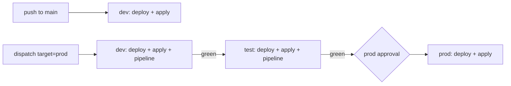

# ADR-0011: Three-stage promotion (dev → test → prod)

- **Status**: Accepted
- **Date**: 2026-11-05
- **Supersedes**: the two-environment decision in [PLAN.md §10](../PLAN.md#10-decisions)

## Context

Until now the bundle had two targets. A push to `main` deployed `dev`; `prod` was a separate manual
`workflow_dispatch` behind a GitHub environment approval. Nothing tied a prod deploy to a passed run:
an approver could release a commit whose pipeline had never run, and dev is a poor rehearsal anyway,
because engineers can write there and data may have been changed by hand.

Free Edition has one workspace and one metastore ([ADR-0001](0001-environments-as-catalogs.md)), and
its compute quota is small, so every extra environment costs pipeline runs.

## Decision

Add a **`test`** environment (`gov_test` catalog, bundle target `test`) and make prod reachable only
through it, in **one workflow run on one commit**:

- **Gate = the pipeline run.** `databricks bundle run lakehouse_pipeline` waits for the run and fails
  on any failed task: quality rules, critical drift, untagged PII, erasure residuals. A failure in dev
  or test stops the promotion before anyone is asked to approve.
- **test is prod-like, dev is not.** Engineers are read-only in test, exactly as in prod; a unit test
  asserts that test's grants equal prod's modulo the catalog name. test is created and owned by
  `gov-deployer` like prod, so drift there means the same as drift in prod.
- **test has no schedule.** Its pipeline runs only as a promotion step; dev keeps the daily run that
  builds scorecard history; prod runs on demand ([cost](../design/scalability-and-cost.md)).
- **One composite action** (`.github/actions/deploy-target`) does validate → ensure-catalog → bundle
  deploy → governance apply → optional pipeline, so the three stages can't drift apart.
- `target=test` with `run_pipeline=false` only deploys. That is how a new test catalog is bootstrapped
  before an account admin creates its audit views (`make audit-views ENV=test`).

## Consequences

- An approver sees two green pipeline runs for the exact commit they are approving.
- A prod promotion costs two pipeline runs (dev and test) before prod: about 2 × 5 minutes of
  serverless compute on Free Edition. That is the price of the gate and is accepted.
- One `deploy` concurrency group for all targets: a push to `main` waits for a running promotion
  instead of redeploying dev underneath it.
- Isolation between test and prod is still logical (catalogs in one workspace). In an enterprise
  account each stage would be its own workspace with catalog bindings
  ([production deltas](../production-deltas.md)); the workflow shape does not change.

## Alternatives considered

- **Keep dev → prod and document why** (cheaper on quota). Rejected: dev is writable by engineers,
  so a green dev run doesn't prove prod will behave, and prod stayed unconnected to any run.
- **Promote by re-running the dev job's artifact** (a built wheel). Not needed: the bundle deploys
  source at a commit, and all three stages check out the same `GITHUB_SHA`.
- **Approval on test as well.** Rejected: the pipeline run is a better gate than a human click; the
  one human decision is kept for prod.
