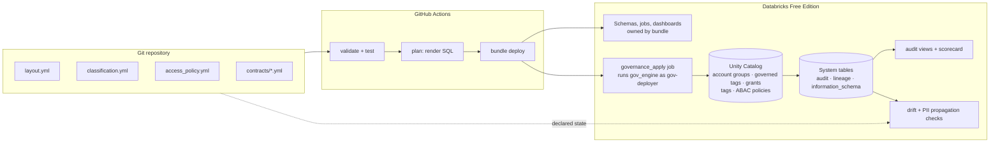
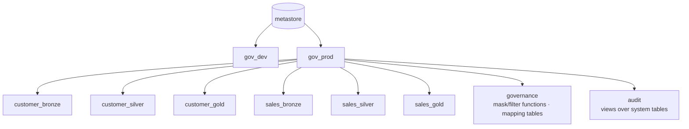
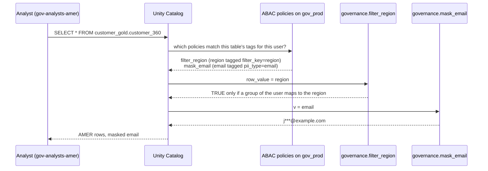
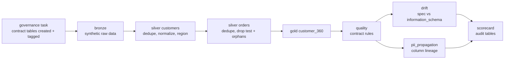
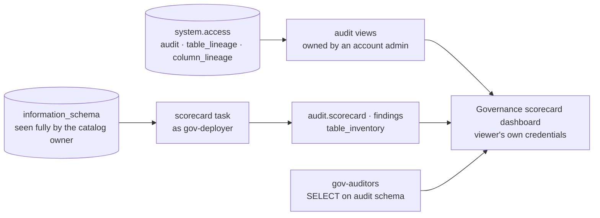

# Architecture

## Control flow: governance as code

## Namespace layout

`gov_dev` has the same structure. Schema names are `<domain>_<layer>`, so a grant can target
"all gold schemas" or "all customer schemas" with a selector in `access_policy.yml`.

## Ownership split

| Concern | Managed by | Why |
|---|---|---|
| Catalog | `gov_engine ensure-catalog` (SQL, before deploy) | Default Storage rejects the catalogs API the bundle uses |
| Schemas, volumes, jobs, dashboards | Databricks Asset Bundle | Declarative infra with targets |
| Account groups, governed tags | `gov_engine` (REST API) | Account-level; must exist before policies reference them |
| Grants, tags, ABAC policies, mask/filter functions, mapping tables | `gov_engine` (SQL) | Not expressible in bundles; policy must be one source of truth |
| Group membership | People (admins) | Who is in a group is an access request, not code |

Each object has exactly one owner so the two systems never overwrite each other ([ADR-0002](adr/0002-governance-as-code-engine.md)).

## Identity model

| Logical principal | Group | Purpose |
|---|---|---|
| `platform_admins` | `gov-platform-admins` | Break-glass, sees all regions |
| `data_engineers` | `gov-data-engineers` | Builds pipelines; write in dev, read-only in prod |
| `analysts_amer` / `analysts_emea` | `gov-analysts-*` | Gold read, rows filtered by region, PII masked |
| `pii_readers` | `gov-pii-readers` | Unmasks **confidential** columns |
| `pii_restricted_readers` | `gov-pii-restricted-readers` | Unmasks **restricted** columns |
| `customer_stewards` / `sales_stewards` | `gov-*-stewards` | Domain owners; can apply tags |
| `auditors` | `gov-auditors` | Read `audit` schema only |
| `pipelines` | `gov-pipeline-runners` | Exempt from masks and row filters, no grants; only member: `gov-deployer` ([ADR-0007](adr/0007-contract-first-tables-and-pipeline-identity.md)) |

Group names live in `access_policy.yml → principals`; everything else refers to logical names.
Groups are created as **account** groups through `/api/2.0/account/scim/v2/Groups`: the plain
workspace SCIM API creates workspace-local groups that Unity Catalog cannot resolve. The engine then
assigns each group to the workspace (`/api/2.0/preview/permissionassignments`), so it appears on the
workspace Groups page and its members can sign in.

Deployments run as the **`gov-deployer`** service principal (OAuth M2M), which owns prod objects
([ADR-0006](adr/0006-deploy-service-principal.md)).

## Policy evaluation at query time (ABAC)

Policies are attached to the catalog and find columns through **governed tags**; the user's groups
decide whether they are in `TO` or `EXCEPT`. Contracts only tag columns, so a new table is protected
as soon as it is tagged ([ADR-0005](adr/0005-native-abac.md)).

## Data flow

The `lakehouse_pipeline` job runs as `gov-deployer`. Contract tables exist and are tagged before the
first row is written; transforms live in `src/transforms/<schema>/<table>.sql`.

`bronze` (raw, engineers only) → `silver` (cleaned, conformed, masked + filtered) → `gold`
(data products with contracts, masked + filtered). Bronze is protected by access, not masks.

## Verification

Both checks run at the end of the pipeline as `gov-deployer`, which owns the catalog and so sees every
grant and policy ([ADR-0008](adr/0008-drift-and-pii-propagation.md)).

- **Drift** compares the spec with `information_schema`: schemas, direct grants, contract columns,
  engine-owned tags, ABAC policies, and per-column masks (which should not exist). Critical drift,
  meaning anything that widens access or weakens protection, fails the run.
- **PII propagation** walks `system.access.column_lineage` downstream from every `pii_type` or
  matched `class.*` column. Bronze columns that feed a tagged column count as raw PII. Any silver or
  gold column fed by PII without a protecting tag fails the run.

## Observability

Auditors read curated views in `audit` and never `system.*` ([ADR-0009](adr/0009-audit-views-and-scorecard.md)).

- **Audit views** (`table_access`, `grant_changes`, `policy_changes`, `access_denied`, `column_lineage`)
  read system tables with their owner's access. An account admin creates them with `make audit-views`.
- **The `scorecard` task** runs after both checks, even if they fail. It writes coverage metrics
  (% owned, % classified, % PII masked), drift and PII findings, and a table inventory with
  classifications.
- **The dashboard** joins both sources at query time: reads of restricted tables, and grant changes
  that gov_engine did not make.
