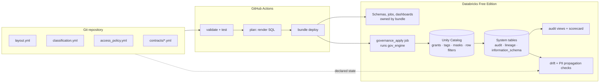
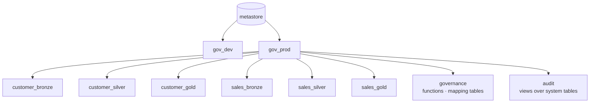
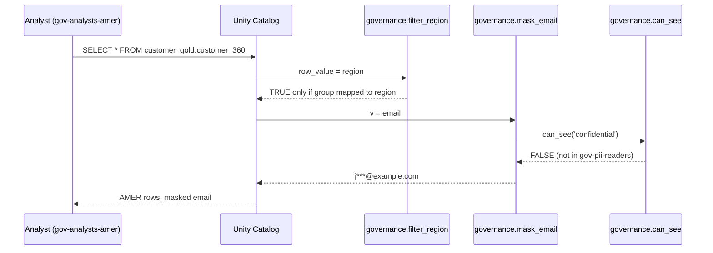

# Architecture

## Control flow: governance as code

## Namespace layout

`gov_dev` has the same structure. Schema names are `<domain>_<layer>`, so a grant can target
"all gold schemas" or "all customer schemas" with a selector in `access_policy.yml`.

## Ownership split

| Concern | Managed by | Why |
|---|---|---|
| Catalogs, groups | Bootstrap (one-time) | Requires admin rights; rarely changes |
| Schemas, volumes, jobs, dashboards | Databricks Asset Bundle | Declarative infra with targets |
| Grants, tags, masks, row filters, mapping tables | `gov_engine` | Not expressible in bundles; policy must be one source of truth |

Each object has exactly one owner so the two systems never overwrite each other ([ADR-0002](adr/0002-governance-as-code-engine.md)).

## Identity model

| Logical principal | Group | Purpose |
|---|---|---|
| `platform_admins` | `gov-platform-admins` | Break-glass, sees all regions |
| `data_engineers` | `gov-data-engineers` | Builds pipelines; write in dev, read-only in prod |
| `analysts_amer` / `analysts_emea` | `gov-analysts-*` | Gold read, rows filtered by region, PII masked |
| `pii_readers` | `gov-pii-readers` | Unmasks **confidential** columns |
| `pii_restricted_readers` | `gov-pii-restricted-readers` | Unmasks **restricted** columns |
| `customer_stewards` / `sales_stewards` | `gov-*-stewards` | Domain owners; can apply tags |
| `auditors` | `gov-auditors` | Read `audit` schema only |

Group names live in `access_policy.yml → principals`; everything else refers to logical names.

## Policy evaluation at query time

All mask functions delegate the "who may see this level" decision to `can_see()`, which is generated
from `classification.yml`. Changing who can unmask a level is a one-line YAML change.

## Data flow

`bronze` (raw, engineers only) → `silver` (cleaned, conformed, masked + filtered) → `gold`
(data products with contracts, masked + filtered). Bronze is protected by access, not masks.
